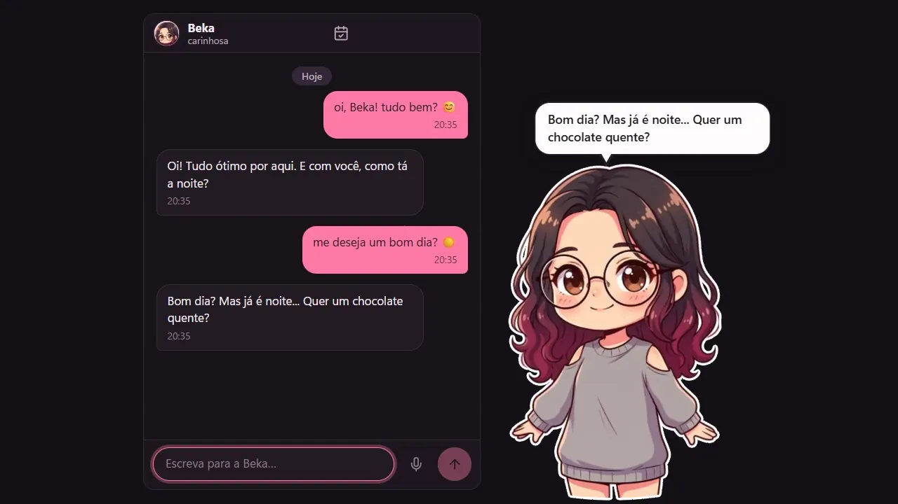
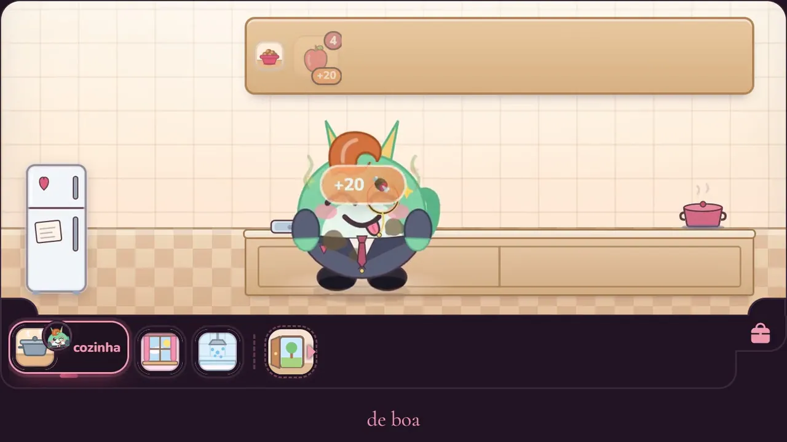
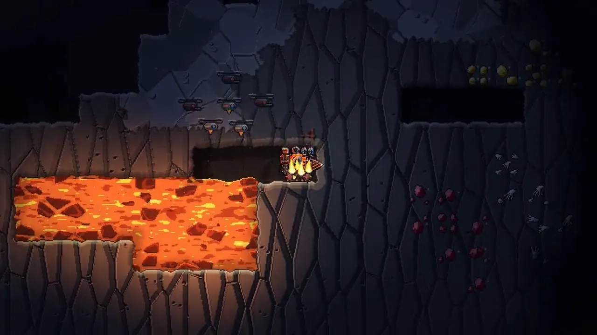
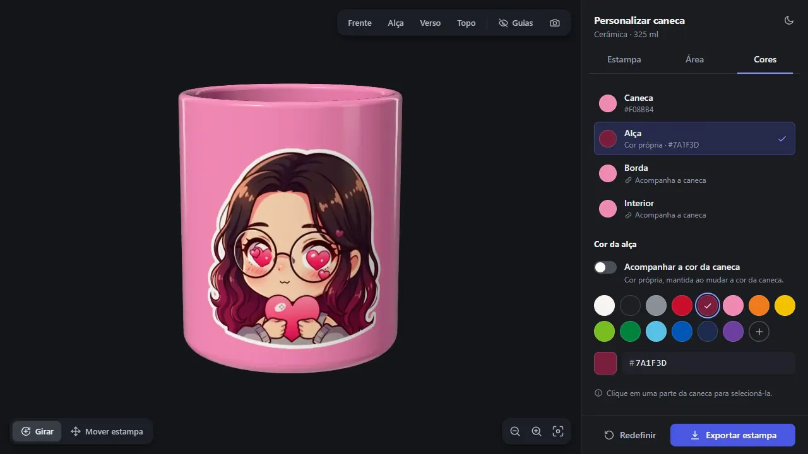
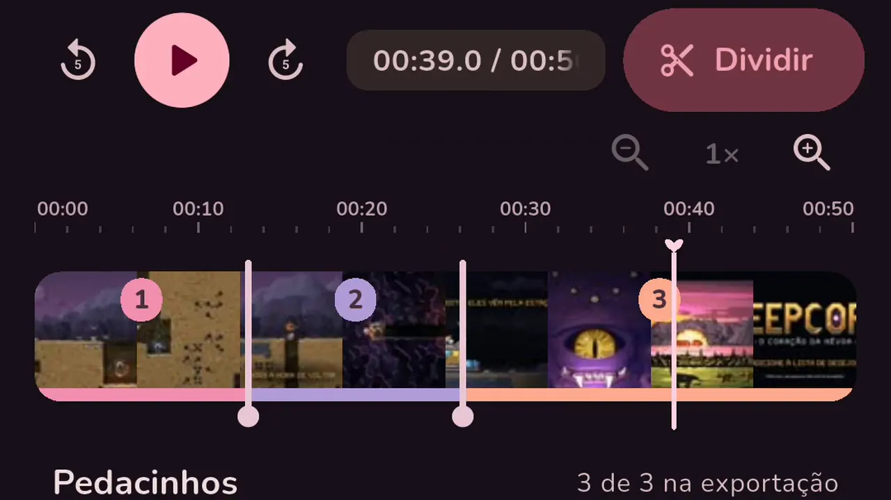

<!--
  README do perfil do GitHub, em inglês. O conteúdo segue o portfólio (AlexsandroFde/Portfolio, src/data/):
  quando um projeto, uma experiência ou uma habilidade mudar lá, atualize aqui também.
  As imagens em assets/projects/ são cópias dos pôsteres do portfólio (src/assets/projects/*.webp).
  Em Skills, toda habilidade tem ícone. Os que o skillicons.dev não tem ficam em assets/skills/,
  no mesmo estilo e em versão clara e escura.
  Nome, foto, bio e localização ficam no perfil do GitHub. Cada informação aparece uma vez só:
  os contatos ficam nos botões do topo, sem uma seção de contato no fim.
-->

[-2D5473?style=for-the-badge&logo=data:image/svg%2Bxml;base64,PHN2ZyB4bWxucz0iaHR0cDovL3d3dy53My5vcmcvMjAwMC9zdmciIHZpZXdCb3g9IjAgMCAyNCAyNCIgZmlsbD0ibm9uZSIgc3Ryb2tlPSIjZmZmIiBzdHJva2Utd2lkdGg9IjIiIHN0cm9rZS1saW5lY2FwPSJyb3VuZCIgc3Ryb2tlLWxpbmVqb2luPSJyb3VuZCI%2BPHBhdGggZD0iTTE1IDJINmEyIDIgMCAwIDAtMiAydjE2YTIgMiAwIDAgMCAyIDJoMTJhMiAyIDAgMCAwIDItMlY3WiIvPjxwYXRoIGQ9Ik0xNCAydjRhMiAyIDAgMCAwIDIgMmg0Ii8%2BPHBhdGggZD0iTTEwIDlIOCIvPjxwYXRoIGQ9Ik0xNiAxM0g4Ii8%2BPHBhdGggZD0iTTE2IDE3SDgiLz48L3N2Zz4%3D)](https://alexsandrofde.github.io/Portfolio/Resume-Alexsandro-Ferreira-da-Silva.pdf)

Prefere português? Veja o [portfólio](https://alexsandrofde.github.io/Portfolio/) e o [currículo](https://alexsandrofde.github.io/Portfolio/Curriculo-Alexsandro-Ferreira-da-Silva.pdf) em português.

## <samp>01</samp> About

I'm a computer engineer, graduated from IFCE in 2026, and I build software for the web, mobile and desktop.

Today I work at Instituto Iracema on **Sala Braille**, an app that supports braille literacy for blind students in inclusive schools. Outside of work, I build my own projects, from an assistant powered by local AI to games and mobile apps. I love learning: when a project calls for a new technology, I dive into it with enthusiasm.

## <samp>02</samp> Projects

I've built 35+ projects so far; here are some of them. The previews open my [portfolio](https://alexsandrofde.github.io/Portfolio/en/#projetos), where each one plays as a short video.

### Featured

<table>
  <tr>
    <td width="50%" valign="top">
      
       <samp>DATA &amp; AUTOMATION · 2026 · 🔒 PRIVATE REPO</samp>
      <h4>Beka</h4>
      
Desktop virtual assistant with local AI and an animated character inspired by my fiancée. She chats, has her own memory and personality, and controls apps on the computer.

      <samp>ELECTRON · TYPESCRIPT · OLLAMA</samp>
    </td>
    <td width="50%" valign="top">
      
       <samp>WEB · 2026 · 🔒 PRIVATE REPO</samp>
      <h4>Nosso Cantinho</h4>
      
Full-stack platform built for my fiancée, with real-time sync. It brings together a virtual pet and many other romantic interactions.

      <samp>REACT · NESTJS · TYPESCRIPT</samp>
    </td>
  </tr>
  <tr>
    <td width="50%" valign="top">
      
       <samp>GAMES · 2026 · 🔒 PRIVATE REPO</samp>
      <h4>DeepCore</h4>
      
2D roguelite about mining, survival and base defense. It combines digging, underground exploration, resource gathering and machine upgrades.

      <samp>GODOT · GDSCRIPT</samp>
    </td>
    <td width="50%" valign="top">
      
       <samp>WEB · 2026</samp>
      <h4><a href="https://github.com/AlexsandroFde/Mug_Customizer">Mug Customizer ↗︎</a></h4>
      
Apply your own prints to a mug, adjust print areas and colors, and see the result in real time.

      <samp>REACT · TYPESCRIPT</samp>
    </td>
  </tr>
  <tr>
    <td width="50%" valign="top">
      <samp>DATA &amp; AUTOMATION · 2026</samp>
      <h4><a href="https://github.com/AlexsandroFde/Transcriber">Transcriber ↗︎</a></h4>
      
Transcribes Brazilian Portuguese meetings from audio and video, identifying participants, labeling each speaker's lines and keeping hesitations and repetitions.

      <samp>PYTHON</samp>
    </td>
    <td width="50%" valign="top" rowspan="2">
      
       <samp>MOBILE · 2026</samp>
      <h4><a href="https://github.com/AlexsandroFde/Video_Cutter">Video Cutter ↗︎</a></h4>
      
App for splitting videos into several segments and exporting them in batch. It accepts local and YouTube videos, with fast or precise cuts and MP3 audio extraction.

      <samp>FLUTTER · DART</samp>
    </td>
  </tr>
  <tr>
    <td width="50%" valign="top">
      <samp>WEB · 2024 · 🔒 PRIVATE REPO</samp>
      <h4>G-LIT</h4>
      
Complete front end of the Technological Innovation Lab (LIT) management system: projects, research fellows and coordinators, with authentication and role-based permissions.

      <samp>REACT · TYPESCRIPT · REST APIS</samp>
    </td>
  </tr>
</table>

<b>Other projects (10)</b>

 

| Project | What it is | Stack | Year |
| --- | --- | --- | :-: |
| [SMS](https://github.com/AlexsandroFde/SMS) | Instant messenger in Java RMI with a Swing interface | Java · RMI · Swing | 2026 |
| [3D Rendering](https://github.com/AlexsandroFde/3D_Rendering) | 3D rendering with perspective projection and rasterization | Python · Matplotlib · PIL | 2025 |
| V-Car&nbsp;🔒 | Customer, order and staff management for a car wash | JavaScript · Node.js · Express | 2024 |
| LIT Portfolio&nbsp;🔒 | The lab's institutional website, integrated with G-LIT | Vue.js | 2023 |
| [Meu Busão](https://github.com/AlexsandroFde/Meu_Busao) | Buying and swapping seats on bus trips | Flutter · Dart · MySQL | 2023 |
| [Math Tool Kit](https://github.com/AlexsandroFde/Math_Tool_Kit) | Number bases, linear systems and roots of equations | C | 2023 |
| [Discord Bot](https://github.com/AlexsandroFde/Bot_Discord) | Moderation and automation bot for Discord servers | Python · discord.py | 2023 |
| TV&nbsp;Automation&nbsp;🔒 | TV control and scheduling with Raspberry Pi | Python · Raspberry Pi | 2023 |
| [Sort Analytics](https://github.com/AlexsandroFde/Sort_Analytics) | Performance comparison of six sorting algorithms | Python | 2023 |
| [TradeIt](https://github.com/AlexsandroFde/TradeIt) | Game trading between users, with Firebase sign-in | Flutter · Dart · Firebase | 2022 |

🔒 Private repository · [All public repositories](https://github.com/AlexsandroFde?tab=repositories)

## <samp>03</samp> Background

### Education

<table>
  <tr>
    <td width="160" valign="top"><samp>2021 – 2026</samp></td>
    <td><b>Bachelor's in Computer Engineering</b> · IFCE, Fortaleza campus Main courses: Data Structures, Object-Oriented Programming, Databases, Searching and Sorting, Microcontrollers and Microprocessors.</td>
  </tr>
</table>

### Experience and activities

<table>
  <tr>
    <td width="160" valign="top"><samp>May 2025 – present</samp></td>
    <td><b><a href="https://institutoiracema.org.br/pt">Instituto Iracema</a></b> · Software Developer · Sala Braille An app with remote lessons and progress tracking for each student, part of an ecosystem that also includes physical devices such as SlateBraille, NoteBraille and BrailleBoard.</td>
  </tr>
  <tr>
    <td width="160" valign="top"><samp>Nov 2024</samp></td>
    <td><b>ENICIT</b> · Research presentation I presented research on using convolutional neural networks (CNNs) to support racial hetero-identification from facial images. I explained the Transfer Learning methodology, the statistical results and the technical and social implications of the solution.</td>
  </tr>
  <tr>
    <td width="160" valign="top"><samp>May 2024</samp></td>
    <td><b>Freelance Developer</b> · Website for a car wash</td>
  </tr>
  <tr>
    <td width="160" valign="top"><samp>Nov 2022</samp></td>
    <td><b>Knowledge Fair</b> · Exhibitor I presented and supervised projects, exchanging and absorbing innovative ideas.</td>
  </tr>
  <tr>
    <td width="160" valign="top"><samp>Oct 2022</samp></td>
    <td><b>Techstars Startup Weekend Fortaleza</b> · 🥇 1st place I was part of a startup's founding team. I attended the talks that supported the project's development, we collected data and refined the idea, and I prepared the winning pitch.</td>
  </tr>
</table>
